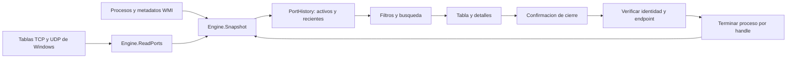

# Arquitectura y funcionamiento

## Plataforma

PortPilot utiliza C# compatible con el compilador de .NET Framework, Windows Forms y las bibliotecas de Windows. No usa NuGet, un servidor web ni un runtime de JavaScript. La interfaz funciona en el equipo local.

Los archivos `src/PortPilot.cs` y `src/Interface.cs` se compilan con `csc.exe`. La configuración fija .NET Framework 4.8 y habilita el ajuste de escala de Windows Forms.

## Flujo de datos

## Lectura de puertos

`Engine.ReadPorts()` consulta `GetExtendedTcpTable` y `GetExtendedUdpTable` de `iphlpapi.dll` para las familias IPv4 e IPv6. TCP se consulta con la tabla de listeners con PID; UDP devuelve endpoints vinculados con PID.

La consulta primero obtiene el tamaño necesario. Si la tabla cambia mientras se lee, vuelve a reservar el búfer y reintenta hasta cinco veces. El bloque de memoria nativo se libera siempre. Se valida que el número de filas quepa en el búfer antes de recorrerlo.

Los puertos se convierten desde el orden de bytes de red. Las direcciones se presentan con `IPAddress`. Cada fila conserva protocolo, dirección, puerto y PID.

Referencias: [GetExtendedTcpTable](https://learn.microsoft.com/windows/win32/api/iphlpapi/nf-iphlpapi-getextendedtcptable), [GetExtendedUdpTable](https://learn.microsoft.com/windows/win32/api/iphlpapi/nf-iphlpapi-getextendedudptable).

## Identificación del proceso

`Engine.Snapshot()` consulta metadatos de `Win32_Process` mediante `System.Management`, y utiliza `System.Diagnostics.Process` para obtener el nombre, la sesión y la hora de creación. La fecha de creación permite verificar que los datos de WMI correspondan al proceso observado.

La clasificación de tecnología se basa en nombres concretos del ejecutable. No se atribuye una tecnología por su número de puerto: un proceso desconocido en 3000 sigue siendo **Otro**. No se analiza la salud del servicio ni el contenido de sus conexiones.

Si Windows no permite consultar la ruta o el comando, la interfaz lo indica. La consulta de procesos puede terminar durante una actualización; el resultado es una instantánea, no una garantía de estado en tiempo real.

## Historial y estados

`PortEntry` representa un endpoint y los metadatos de su proceso. Su identidad combina protocolo, dirección, puerto, PID y fecha de creación.

`PortHistory.Merge()` combina la instantánea nueva con los registros anteriores:

1. Los registros observados están activos.
2. Los que dejan de aparecer conservan la primera hora de desaparición.
3. Los inactivos se conservan cinco minutos, con un máximo de 500.
4. Si una identidad reaparece, vuelve a estar activa sin duplicarse.
5. Si otro proceso ocupa el mismo puerto, se conserva como una identidad distinta.

El historial solo vive en memoria. Una consulta fallida conserva la vista anterior y muestra un aviso; no marca todo como inactivo.

## Cierre de un proceso

La interfaz y el motor rechazan registros inactivos. `BlockReason()` bloquea PID de sistema, nombres protegidos, sesión 0, la propia app y procesos sin identidad suficiente.

Después de la confirmación, `Engine.Stop()`:

1. Abre un handle con permisos de consulta, terminación y sincronización.
2. Lee la hora de creación con `GetProcessTimes` y la compara con la identidad seleccionada.
3. Consulta `IsProcessCritical` y rechaza procesos críticos.
4. Comprueba de nuevo que el PID siga ocupando el endpoint seleccionado.
5. Llama a `TerminateProcess` usando **el mismo handle** validado.
6. Espera hasta cuatro segundos a que termine y libera el handle.

Usar el mismo handle evita que una reutilización del PID entre la verificación y el cierre termine un proceso distinto. La terminación es forzada y afecta al proceso completo; no incluye una terminación recursiva de procesos hijos.

Referencias: [GetProcessTimes](https://learn.microsoft.com/windows/win32/api/processthreadsapi/nf-processthreadsapi-getprocesstimes), [IsProcessCritical](https://learn.microsoft.com/windows/win32/api/processthreadsapi/nf-processthreadsapi-isprocesscritical), [TerminateProcess](https://learn.microsoft.com/windows/win32/api/processthreadsapi/nf-processthreadsapi-terminateprocess).

## Interfaz

`MainForm` coordina filtros, tabla, selección, exportación y actualización. Las consultas se ejecutan con `Task.Run` para mantener la ventana disponible. Un indicador de operación evita actualizaciones o cierres simultáneos desde la interfaz.

`Interface.cs` contiene superficies redondeadas, botones, selectores y tarjetas de métricas. Los selectores conservan navegación por teclado. El menú emergente se libera en el siguiente ciclo de interfaz, una vez completado el evento de selección.

El diseño usa una altura base de 40 px para los controles de entrada y botones, un ancho máximo de contenido y etiquetas de estado con texto además de color. La escala DPI se gestiona mediante Windows Forms; la validación visual realizada no cubre todas las configuraciones de monitores.

## CSV y datos locales

La exportación utiliza UTF-8 con BOM. Los valores se entrecomillan, se escapan las comillas y se antepone una comilla simple a valores que pudieran interpretarse como fórmulas. No se exportan comandos de ejecución. Las rutas y direcciones siguen siendo datos del equipo: el usuario decide si comparte el archivo.

## Compilación continua

El flujo de GitHub Actions ejecuta la compilación y el empaquetado en Windows con permisos de lectura del repositorio. No publica automáticamente una Release y no ejecuta la terminación de procesos del test de integración.

Las acciones utilizadas se documentan en sus repositorios oficiales: [actions/checkout](https://github.com/actions/checkout) y [actions/upload-artifact](https://github.com/actions/upload-artifact).
